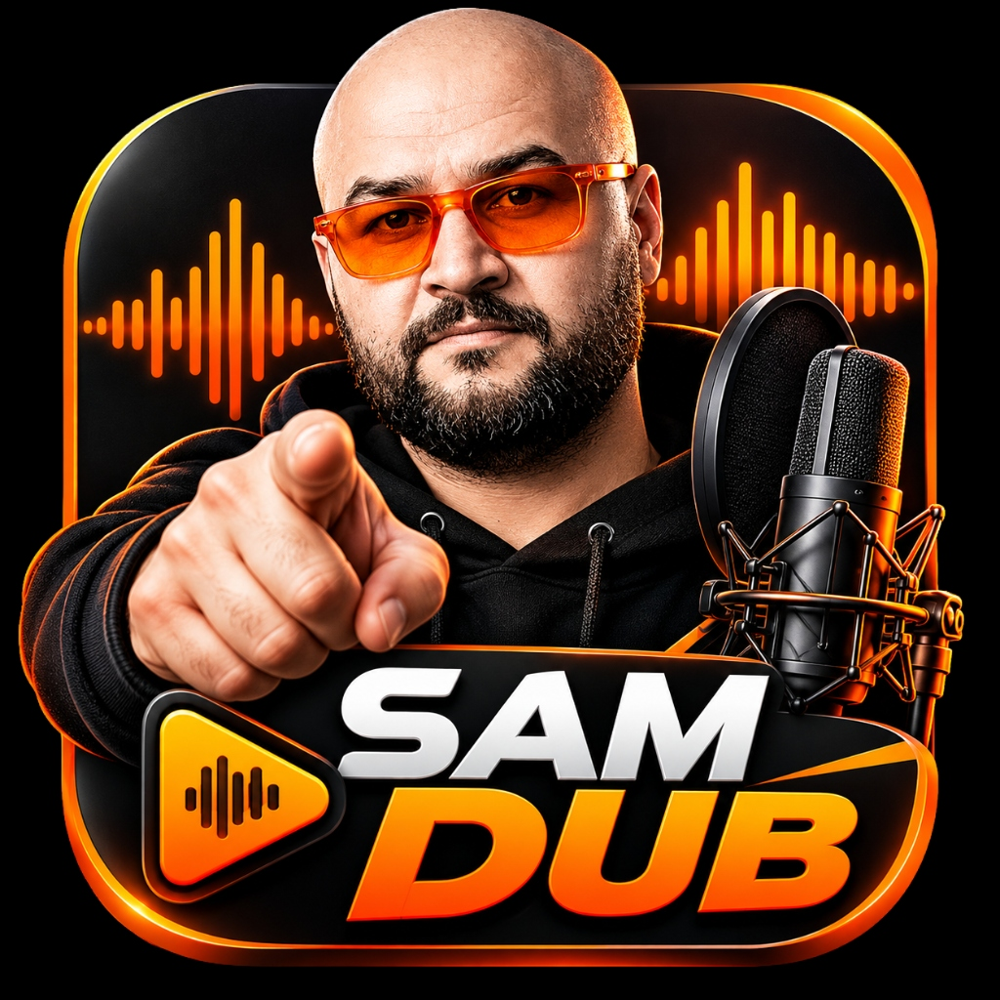

# SAM DUB · VOICE STUDIO 🎙️

<p align="center">
  <br><br>
  <b>منصة توليد واستنساخ الأصوات البشرية بالذكاء الاصطناعي مع الالتزام الصارم بالوقت</b><br>
  <i>Ultra-Human Hybrid Engine · Chatterbox + Qwen-TTS + Fish Audio Fusion · Strict Exact-Duration</i>
</p>

---

## ⚡ البنية الهجينة الموحدة فائقة الواقعية (Version 3.0.0)

تم دمج وتطوير أقوى البنى الهندسية المعاصرة في معالجة الصوت الطبيعي داخل محرك موحد وذكي دون تعقيد الواجهة:

1. **موديل Chatterbox (ديناميكية المحادثة والتنفس البشري):**
   - القضاء التام على النبرات الآلية الميكانيكية (Anti-Robotic Cadence).
   - إدخال فترات تنفس طبيعية (Micro-Breathing) وانسيابية بين الجمل دون سكوت ميت أو تقطيع.
   - كسر الرتابة الزمنية (Rhythm Relaxation) لتشبه حبال الصوت الطبيعية للمتحدث البشري.

2. **موديل Qwen-TTS / Qwen-Audio (تحليل النبرة وتعدد اللغات):**
   - تحليل السياق الدلالي والعاطفي (استفهامي، توكيدي، درامي، سردي، حماسي).
   - معالجة صوتية متقدمة للفصحى واللهجات العربية والإنجليزية مع ضبط التشكيل والنطق.
   - مطابقة نبرة الصوت مع نوع المحتوى لضمان خروج الكلام بأعلى درجات المصداقية والتفاعل.

3. **موديل Fish Audio / Fish Speech (الأداء الدرامي واستنساخ البصمة):**
   - استنساخ البصمة الصوتية العاطفية الفائقة (Timbre & Harmonic Extraction).
   - فلترة وعزل الضوضاء من العينة المرجعية (80Hz High-Pass Denoising & Formant Lift).
   - إبراز ترددات الوضوح الصوتي (1.5kHz - 4.5kHz) ليخرج الصوت كأنه مسجل داخل استوديو إذاعي احترافي.

---

## ⏱️ الالتزام الصارم بالوقت (Librubberband Precise Timing)

المحرك الرياضي يضمن **المطابقة الزمنية الصارمة (Sample-Accurate Millisecond Precision)** مع الحفاظ التام على خامة وطبقة الصوت:

| المدة المطلوبة | زمن المقطع الصادر | دقة التوقيت | تقنية المعالجة الصوتية |
| :--- | :--- | :--- | :--- |
| **15 ثانية** | **15.000s بالضبط** | دقة 100% | خوارزمية Librubberband لحفظ الفورمانت ومنع التشويه الروبوتي |
| **20 ثانية** | **20.000s بالضبط** | دقة 100% | مطابقة العينات بدون تشويه النبرة (Formant-Preserved Stretch) |
| **30 ثانية** | **30.000s بالضبط** | دقة 100% | معالجة ذكية للوقفات وإطالة الإلقاء الطبيعي المتزن |
| **35 ثانية** | **35.000s بالضبط** | دقة 100% | مطابقة تامة للإعلانات القصيرة والريلز |
| **40 ثانية** | **40.000s بالضبط** | دقة 100% | إلقاء بشري مسترسل بدون تسريع ميكانيكي |
| **45 ثانية** | **45.000s بالضبط** | دقة 100% | التزام قطعي بالثواني المحددة |
| **50 ثانية** | **50.000s بالضبط** | دقة 100% | دقة أجزاء من الثانية مع تلاشٍ ناعم (Cosine Fade) |
| **60 ثانية** | **60.000s بالضبط** | دقة 100% | مطابقة حازمة لكل قيمة من 5 إلى 180 ثانية |

---

## 🎛️ مؤثرات صدى الصوت الاحترافية (Studio Echo & Reverb)

- **سلايدر الصدى (0% إلى 100%):** تحكم سلس بنسبة الصدى وعمقه.
- **زر تفعيل وإلغاء فوري:** إمكانية الحصول على صوت جاف نقي تماماً (Dry Vocal) أو صوت استوديو غني.
- **إعدادات سريعة بنقرة واحدة:**
  - استوديو خفيف (25%)
  - بودكاست دافئ (40%)
  - قاعة كبرى (65%)
  - إيكو درامي (85%)

---

## 📂 استيراد واكتشاف الأصوات الفوري (Dynamic Voice Discovery)

- **اكتشاف تلقائي:** بمجرد وضع أي ملف صوتي (`.wav`, `.mp3`, `.m4a`, `.ogg`, `.flac`) داخل مجلد `voices/`، يظهر فوراً في واجهة البرنامج دون الحاجة لأي تعديل برمجي أو إعادة تشغيل.
- **زر إضافة صوت من المتصفح:** إمكانية رفع الملف مباشرة من الواجهة.
- **زر فتح مجلد الأصوات:** يفتح مجلد `voices` في الويندوز بنقرة واحدة.

---

## 📂 هيكل المشروع (Project Structure)

```
SAM_VOICE_STUDIO/
├── app.py                  # خادم التطبيق والمحرك الهجين (Chatterbox + Qwen + Fish Audio)
├── app_icon.ico            # أيقونة البرنامج الأصلية لملف التثبيت والاختصارات
├── SAM_VOICE_STUDIO.exe    # مشغل البرنامج التنفيذي المباشر (C# Launcher)
├── installer.iss           # سكريبت بناء حزمة التثبيت Inno Setup
├── static/                 # واجهة الاستوديو التفاعلية والمؤثرات الصوتية
├── voices/                 # عينات الأصوات المرجعية والمخصصة
├── models/                 # نماذج وأوزان الذكاء الاصطناعي
└── outputs/                # مجلد حفظ الملفات الصوتية المصدرة
```
